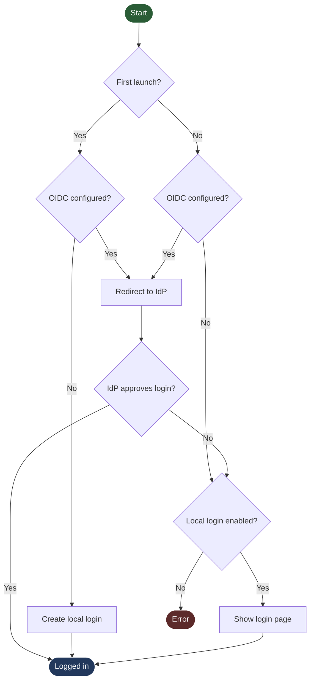

# oidcgate

Login for any `net/http` Go app in two lines, configured by environment
variables: a local account created on first launch, plus optional OpenID
Connect (Authelia, Authentik, Keycloak, Entra ID, …).

```go
gate, err := oidcgate.FromEnv(ctx, "myapp") // reads MYAPP_* env vars
if err != nil {
	log.Fatal(err) // misconfigured: refuse to start rather than serve unprotected
}
handler = gate.Wrap(handler) // no-op when the gate is off
```

The gate owns all of authentication: the login, setup and error pages, the
local account, sessions, the OIDC flow and the routes under `/auth/`. The app
has no code for any of it; remove the two lines and it has no idea an account
ever existed.

It is **on by default**. An app that deliberately relies on something else
(e.g. forward auth at a proxy) sets `MYAPP_AUTH_DISABLED=true`.

## How a visit is routed



- **First launch** means no local account exists yet.
- **Local login enabled** means it isn't turned off with
  `MYAPP_OIDC_DISABLE_BUILT_IN_LOGIN`, and an account exists to sign in with
  (so a rejected OIDC login on a first launch ends in the error page).
- Page loads are redirected; `fetch`/XHR and API clients get
  `401 {"error":"unauthorized"}`.
- After a rejected OIDC login the gate shows a page and never redirects to the
  IdP again, so a rejection cannot loop.
- `/auth/login` is always reachable directly: the way in with the local account
  when the IdP is down.
- An IdP that is unreachable at startup is not fatal. The gate retries in the
  background and the local login works meanwhile.
- With OIDC configured, setup is closed: nobody can claim the app by being first.

## Configuration

`<APP>` is the name passed to `FromEnv`, upper-cased, non-alphanumerics → `_`.

| Variable | |
|---|---|
| `<APP>_AUTH_DISABLED` | `true`: no gate at all. |
| `<APP>_AUTH_PUBLIC_PATHS` | Comma-separated paths that skip auth, added to `/healthz`. A trailing `/` makes a prefix. |
| `<APP>_OIDC_ENABLED` | `true` turns OIDC on. Then all four below are required. |
| `<APP>_OIDC_ISSUER` | IdP issuer URL, e.g. `https://auth.example.com`. |
| `<APP>_OIDC_CLIENT_ID`, `_CLIENT_SECRET` | The client registered at the IdP. |
| `<APP>_OIDC_BASE_URL` | The app's external URL, no path: `https://myapp.example.com`. |
| `<APP>_OIDC_DISABLE_BUILT_IN_LOGIN` | `true`: OIDC is the only way in; the local form is hidden **and** refused by the server. Ignored (with a warning) without OIDC. |

Missing OIDC settings or a malformed boolean make `FromEnv` return an error.

**At the IdP:** register a confidential client with redirect URI
`<BASE_URL>/auth/callback` (logged at startup), scopes `openid profile email`,
and `client_secret_basic`. PKCE `S256` is always used. **Who may sign in is
decided at the IdP**; the gate stores no identity, only that a browser is
authorized.

## State

`/app/data/auth/auth.json` (directory `0700`, file `0600`): the account's
username and **bcrypt hash**, and the key that signs session cookies. It lives
in the app's existing `/app/data` volume, must be writable by the app's user
(startup fails with a clear message if not), and can't be moved. Sessions are
signed `HttpOnly`, `SameSite=Lax` cookies (`Secure` over HTTPS or
`X-Forwarded-Proto: https`) with a sliding 7-day life, and survive restarts.

**Forgot the password?** Stop the app, delete `auth.json`, start it again; the
setup page returns. There is no password-change page.

## A Sign out button

The gate can't choose where your UI puts a button, so the app does; the gate
only announces itself:

```html
<script src="/auth/client.js"></script>   <!-- in <head> -->
<style>html:not([data-oidcgate]) .only-with-gate { display: none !important }</style>

<a class="only-with-gate" href="/auth/logout">Sign out</a>
```

`/auth/client.js` sets `document.documentElement.dataset.oidcgate = "on"`. With
the gate off it is a 404, the attribute never appears, and everything marked
`only-with-gate` stays hidden.

## Security

bcrypt (cost 12, 8–72 bytes) with timing equalised for unknown users; local
login rate-limited to 5 failures a minute, process-wide (OIDC unaffected);
double-submit CSRF token plus `Sec-Fetch-Site`; OIDC with PKCE, `state`,
`nonce` and full ID-token verification via
[go-oidc](https://github.com/coreos/go-oidc); `?next=` accepted only as a local
path and every redirect re-checked; static gate pages with a strict CSP and
`no-store`. Tokens and secrets are never logged.

This is security-critical code. It is tested (`-race`) and scanned (`gosec`,
`govulncheck`) but has had no independent review.

## Limits

One local account, no password change; `BASE_URL` can't contain a path; each
host needs its own IdP client; it answers "is this browser signed in?", nothing
finer.

Sessions are stateless cookies, so **logout clears this browser's cookie but
can't revoke a copy of it**; a stolen cookie lives until it expires (7 days,
sliding). To end every session, stop the app, delete `auth.json` (which also
removes the account) and start it again.

## Testing

- `make test-unit`: every flow in-process against a fake IdP.
- `make test-integration` (needs docker): the gate as it ships, in a container
  as a non-root user next to a fake IdP, one compose stack per scenario under
  `hack/fixtures/<suite>/<scenario>/`. Builds everything from source; offline.
- `make scan`: `go vet`, `gosec`, `govulncheck`. Use the latest Go patch release.

Options for the rare case the environment isn't enough: `WithPublicPaths`,
`WithSessionTTL`, `WithLogger`, `WithDataDir`, or build a `Config` and call
`oidcgate.New(ctx, cfg)`.
