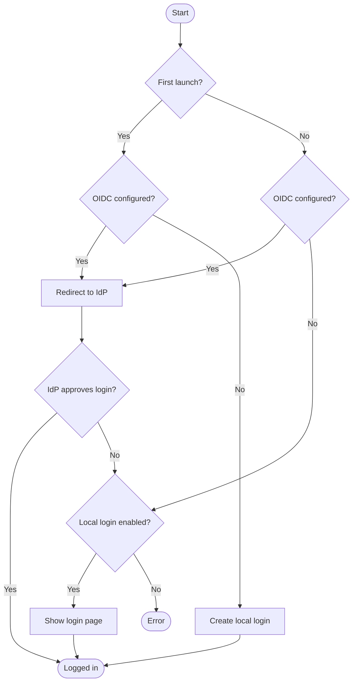

# authy

A drop-in auth gate for any `net/http` Go app, configured by environment
variables. **Two lines and no configuration** → the app is protected by a
local account the first visitor creates. **Add the `OIDC_*` variables** → the
IdP (Authelia, Authentik, Keycloak, Entra ID, …) takes over sign-in, and the
gate is a relying party.

```go
gate, err := authy.FromEnv(ctx, "myapp") // reads MYAPP_* env vars
if err != nil {
	log.Fatal(err) // misconfigured: refuse to start rather than serve unprotected
}
handler = gate.Wrap(handler) // no-op when the gate is off
```

The gate owns all of authentication: the sign-in methods, sessions, sign-out
and the routes under `/auth/`. The app has no code for any of it; remove the
two lines and it has no idea any of it existed. With OIDC configured, who may
sign in is decided at the provider; the gate verifies the sign-in and records
that the browser is authorized and who it is.

It is **on by default**. An app that deliberately relies on something else
(e.g. forward auth at a proxy) sets `MYAPP_AUTH_DISABLED=true`.

## How a visit is routed

Methods are chosen by environment, defaulting to "always protected":



- **No `OIDC_*` variables** → the local account is the method: the first
  visitor creates the single account on `/auth/setup`, every later visit signs
  in on `/auth/local`. No OIDC *and* `LOCAL_ENABLED=false` is a configuration
  error: the gate refuses to start rather than serve unprotected.
- **OIDC configured** → page loads go straight to the IdP, and **setup stays
  closed**: nobody can claim the app by being first. `fetch`/XHR and API
  clients get `401 {"error":"unauthorized"}`.
- **When the IdP rejects (or is unreachable)**: with `<APP>_LOCAL_ENABLED=true`
  the fallback page also offers the local account — the escape hatch; without
  it, the page offers only a retry, never a loop.
- `/auth/login` is the GET-only fallback page: one button per sign-in method,
  and the error after a failed or unavailable attempt. It never redirects, so
  a rejection at the IdP cannot loop.
- An IdP that is unreachable at startup is not fatal. The gate retries in the
  background and the fallback page says "not reachable" meanwhile.

## Configuration

`<APP>` is the name passed to `FromEnv`, upper-cased, non-alphanumerics → `_`.
With no variables at all the gate runs on the local account; the four OIDC
variables are **required together**.

| Variable | |
|---|---|
| `<APP>_AUTH_DISABLED` | `true`: no gate at all. |
| `<APP>_AUTH_PUBLIC_PATHS` | Comma-separated paths that skip auth, added to `/healthz`. A trailing `/` makes a prefix. |
| `<APP>_OIDC_ISSUER` | IdP issuer URL, e.g. `https://auth.example.com`. |
| `<APP>_OIDC_CLIENT_ID`, `_CLIENT_SECRET` | The client registered at the IdP. |
| `<APP>_OIDC_BASE_URL` | The app's external URL, no path: `https://myapp.example.com`. |
| `<APP>_LOCAL_ENABLED` | Overrides the default (local account on exactly when OIDC is off): `true` keeps it next to OIDC as an escape hatch; `false` without OIDC is an error. |

Missing settings or a malformed boolean make `FromEnv` return an error.

**At the IdP:** register a confidential client with redirect URI
`<BASE_URL>/auth/callback` (logged at startup), scopes `openid profile email`
(plus `groups` if the app asks for it, see below), and `client_secret_basic`.
PKCE `S256` is always used. **Who may sign in is decided at the IdP**; the gate
checks the sign-in and records that the browser is authorized and who it is.

## Knowing who is signed in

An app that needs to tell people apart (roles, per-user records) asks the gate:

```go
gate, err := authy.FromEnv(ctx, "myapp", authy.WithScopes("openid", "profile", "email", "groups"))
// ...
func handler(w http.ResponseWriter, r *http.Request) {
	u, ok := authy.UserFrom(r)
	if !ok { /* nobody: treat as signed out */ }
	if u.InGroup("admins") { /* ... */ }
}
```

`User` has `Subject` (the IdP's stable `sub`), `Name` (for display, not an
identifier), `Email` and `Groups`. The local account yields
`Subject: "local:<username>"`, `Name: <username>` and no groups; the `local:`
namespace is reserved for it, so no IdP subject can collide with it.

- `WithScopes` is an option, not an environment variable: which scopes an app
  needs belongs to its code, not to a deployment. `openid` is always requested.
  The IdP has to allow them for the client too.
- **Groups need the `groups` scope.** Some providers (Authelia by default)
  serve them from the UserInfo endpoint rather than in the ID token; the gate
  asks UserInfo when groups were requested and the ID token has none. If groups
  were asked for and cannot be read (UserInfo fails, or answers for a different
  subject), **the sign-in fails**: an app that decides by groups must not get a
  user whose groups are unknown. A user with no groups at all signs in normally.
- The identity lives in the signed session cookie, so it is as old as the
  sign-in. **A change of group at the IdP takes effect at the next sign-in**,
  which with a sliding session can be days; set `WithSessionTTL` to the staleness
  you can accept.
- Values are cleaned first (control characters stripped, at most 32 groups of 64
  bytes each, a longer value is dropped whole, never cut). A dropped group can
  only take access away. A subject is required.
- `UserFrom` reports `false` on a public path, with the gate off, and for a
  session from before this existed. Those sessions stay valid, so an app that
  does not use identities is unaffected by upgrading.

## State

`/app/data/auth/auth.json` (directory `0700`, file `0600`): the key that signs
session cookies, and the revoked session IDs from sign-outs. With the local
account enabled, `local.json` (also `0600`) sits next to it and holds the single
username and its bcrypt hash — never a plaintext password. Both live in the
app's existing `/app/data` volume, must be writable by the app's user (startup
fails with a clear message if not), and can't be moved. Sessions are signed
`HttpOnly`, `SameSite=Lax` cookies (`Secure` over HTTPS or
`X-Forwarded-Proto: https`) with a sliding 7-day life, and survive restarts.
However often a session is renewed, it ends for good four lifetimes (28 days)
after sign-in.

**To reset the local account, delete both `local.json` and `auth.json`** and
restart: deleting only `local.json` reopens setup but leaves the signing key,
so sessions from the old account stay valid until they expire.

## A Sign out button

The gate can't choose where your UI puts a button, so the app does; the gate
only announces itself:

```html
<script src="/auth/client.js"></script>   <!-- in <head> -->
<style>html:not([data-authy]) .only-with-gate { display: none !important }</style>

<a class="only-with-gate" href="/auth/logout">Sign out</a>
```

The sign-out refuses cross-site requests (`Sec-Fetch-Site`), so another site
can't sign your users out with a crafted link, and lands on a small "signed
out" page rather than bouncing straight back into the IdP's single sign-on.

`/auth/client.js` sets `document.documentElement.dataset.authy = "on"`. With
the gate off it is a 404, the attribute never appears, and everything marked
`only-with-gate` stays hidden.

## Apps that want a local account

Set `<APP>_LOCAL_ENABLED=true` (or `authy.WithLocalLogin(true)`). The gate does
this properly itself: the account is just another sign-in method behind the
same session, sign-out and identity, so there is nothing to compose by hand.
Next to OIDC it is the break-glass login for when the IdP is down or says no;
note that setup stays open until the account exists, so create it right after
enabling.

## Security

OIDC with PKCE, `state`, `nonce` and full ID-token verification via
[go-oidc](https://github.com/coreos/go-oidc); sign-out refused for cross-site
requests (`Sec-Fetch-Site`); `?next=` accepted only as a local path and
every redirect re-checked; static gate pages with a strict CSP and `no-store`.
Tokens and secrets are never logged.

The local account: a single account, password hashed with bcrypt (cost 12,
passwords capped at 72 bytes because bcrypt ignores the rest); a process-wide
rate limiter (5 failures → `429` with `Retry-After` for a minute); double-submit
CSRF tokens plus `Sec-Fetch-Site` on the setup and login forms; setup closed
for good once the account exists when OIDC is configured. Methods only
authenticate — **only the shell mints sessions**, and it enforces the `local:`
subject namespace in both directions, so an IdP token whose `sub` is literally
`local:admin` can never collide with the local account.

This is security-critical code. It is tested (`-race`) and scanned (`gosec`,
`govulncheck`) but has had no independent review.

## Limits

`BASE_URL` can't contain a path; each host needs its own IdP client; it answers
"who is signed in, and in which groups?", and leaves what each may do to the
app.

Sessions are stateless cookies with a signed session ID. Signing out revokes
that ID (persisted in `auth.json`), so **every copy of the cookie dies with the
sign-out**, and no session outlives four lifetimes (28 days) after sign-in no
matter how often it is renewed. To end every session at once, stop the app,
delete `auth.json` and start it again (the signing key rotates).

## Testing

- `make test-unit`: every flow in-process against a fake IdP.
- `make test-integration` (needs docker): the gate as it ships, in a container
  as a non-root user next to a fake IdP, one compose stack per scenario under
  `hack/fixtures/<suite>/<scenario>/`. Builds everything from source; offline.
- `make scan`: `go vet`, `gosec`, `govulncheck`. Use the latest Go patch release.

Options for the rare case the environment isn't enough: `WithPublicPaths`,
`WithSessionTTL`, `WithScopes`, `WithLogger`, `WithDataDir`, or build a
`Config` and call `authy.New(ctx, cfg)`.
